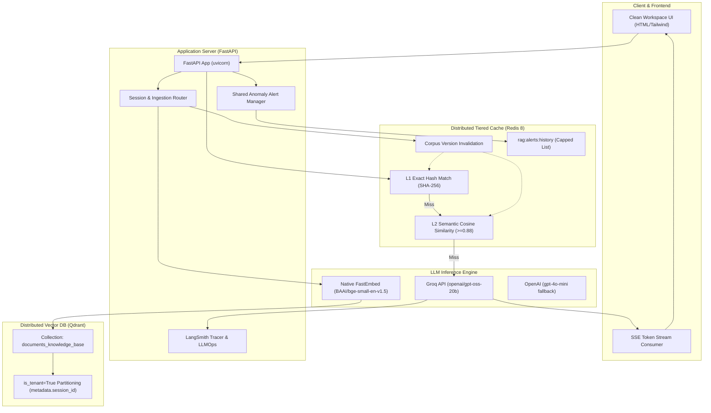

# 🚀 End-to-End Advanced RAG Project with LLMOps

[](https://github.com/KodewithArun/End-to-End-Advanced-RAG-Project-with-LLMOPS-/actions)
[](https://hub.docker.com/r/contactwitharunlaudar/rag-app)
[](https://www.python.org/)
[](https://fastapi.tiangolo.com/)
[](https://qdrant.tech/)
[](https://redis.io/)
[](https://smith.langchain.com/)

An enterprise-grade, production-ready GenAI Document Portal built with an **Advanced Conversational Retrieval-Augmented Generation (RAG)** pipeline, asynchronous **FastAPI** backend, distributed vector search (**Qdrant**), tiered semantic caching (**Redis 8**), real-time token streaming (**Server-Sent Events**), automated testing (**pytest**), and end-to-end **LLMOps observability** (**LangSmith**).

---

## 🏛️ System Architecture



---

## ✨ Key Features

* **Multi-Document Ingestion:** High-speed parallel parsing of PDF, DOCX, and TXT documents with automated OCR fallback (RapidOCR).
* **Multi-Tenant Session Partitioning:** Single-collection architecture in Qdrant server using payload-based `is_tenant=True` keyword filtering on `metadata.session_id` — zero cross-tenant vector leakage and zero collection sprawl.
* **Tiered Semantic Caching (~100x Latency Reduction):**
  * **L1 Exact Match:** SHA-256 string hash lookup in Redis 8 (<2ms).
  * **L2 Semantic Match:** Vector cosine similarity match ($\ge 0.88$).
  * Accelerates repeated and paraphrased queries from **~1000ms down to 10ms**.
* **Zero-Leak Corpus Invalidation:** Re-ingesting or modifying documents increments session `corpus_version`, instantly invalidating stale cached responses.
* **Real-Time Token Streaming:** Asynchronous Server-Sent Events (`/api/v1/chat/stream`) yielding tokens with cache acceleration flags.
* **Production LLMOps Observability:**
  * Automated span tracing via **LangSmith** with run ID attribution.
  * Real-time operational anomaly detection for latency spikes and negative user feedback.
  * Shared Redis-backed anomaly buffer (`rag:alerts:history`) accessible across all worker processes.
* **Modern Packaging & CI/CD:**
  * Lightning-fast dependency management with Astral `uv`.
  * Pre-warmed embedding model weights baked into production Docker images.
  * Automated GitHub Actions CI pipeline running linting, live service integration tests, smoke tests, and multi-registry publishing to **Docker Hub** and **GHCR**.

---

## ⚡ Performance & Benchmarks

| Query Type | Inference Engine | Typical Latency | Cache Acceleration |
| :--- | :--- | :--- | :---: |
| **Cold RAG Query** | Groq (GPT-OSS-20B) | ~800ms – 1100ms | ❌ False |
| **Paraphrased Query** | Redis 8 Semantic Cache | **~10ms – 25ms** | ✅ True (L2 Semantic Hit) |
| **Identical Query** | Redis 8 Exact Cache | **~2ms – 5ms** | ✅ True (L1 Exact Hit) |

---

## 🚀 Quickstart with Docker Compose (Recommended)

Run the entire distributed multi-container production stack (`rag-app`, `rag-redis`, `rag-qdrant`) with a single command:

### 1. Clone & Setup Environment
```bash
git clone https://github.com/KodewithArun/End-to-End-Advanced-RAG-Project-with-LLMOPS-.git
cd End-to-End-Advanced-RAG-Project-with-LLMOPS-
cp .env.example .env
```
Edit `.env` and add your `GROQ_API_KEY` (and optionally `LANGCHAIN_API_KEY`).

### 2. Launch Stack
```bash
docker compose up -d --build
```

### 3. Access Services
* **Web UI Portal:** [http://localhost:8000](http://localhost:8000)
* **API Documentation (Swagger):** [http://localhost:8000/docs](http://localhost:8000/docs)
* **Qdrant Vector DB Dashboard:** [http://localhost:6333/dashboard](http://localhost:6333/dashboard)
* **Redis 8 Host Port:** `localhost:6380`

### 4. Pull Directly from Docker Hub
You can also pull the pre-built, published container image directly:
```bash
docker pull contactwitharunlaudar/rag-app:develop
```

---

## 💻 Local Development Setup

### Prerequisites
* Python 3.12+
* [Astral `uv`](https://github.com/astral-sh/uv) (recommended) or `pip`
* Docker (for Redis and Qdrant backend services)

### Installation
```bash
# 1. Install dependencies using uv
uv sync

# 2. Start Redis 8 and Qdrant containers
docker compose up -d redis qdrant

# 3. Run the full test suite (37 tests)
uv run pytest -v tests/ --cov=multi_doc_chat

# 4. Start local development server
uv run uvicorn main:app --host 0.0.0.0 --port 8000 --reload
```

---

## 📡 API Reference

| Endpoint | Method | Description |
| :--- | :---: | :--- |
| `/api/v1/ingest` | `POST` | Upload and chunk documents (`.pdf`, `.docx`, `.txt`) into vector storage. |
| `/api/v1/chat` | `POST` | Query documents with conversational history, cache lookup, and source citations. |
| `/api/v1/chat/stream` | `POST` | Real-time token streaming over Server-Sent Events (SSE). |
| `/api/v1/feedback` | `POST` | Record user feedback scores (1 to 5) linked to LangSmith trace run IDs. |
| `/api/v1/alerts` | `GET` | Retrieve real-time operational alerts, latency anomalies, and stats. |
| `/api/v1/sessions` | `GET` | List all active multi-tenant document sessions. |
| `/api/v1/sessions/{id}` | `DELETE`| Remove a session, its disk indexes, and vector points. |
| `/healthz` | `GET` | Container and Kubernetes healthcheck probe. |

---

## 🧪 Testing & Code Quality

The project includes unit and integration tests covering data ingestion, vector partitioning, tiered cache operations, SSE streaming, and alerting:

```bash
# Run all tests with coverage report
uv run pytest -v tests/ --cov=multi_doc_chat --cov-report=term-missing

# Run Ruff linter and code formatting
uv run ruff check .
```

---

## 🔄 CI/CD Pipeline (GitHub Actions)

Every push to `main` and `develop` triggers the automated workflow defined in [`.github/workflows/ci.yml`](.github/workflows/ci.yml):

1. **Linting & Code Quality:** Enforces clean imports and Python standards via Ruff.
2. **Automated Integration Tests:** Boots live `redis:8` and `qdrant` service containers to execute the full test suite.
3. **Smoke Verification:** Builds Docker Compose stack and asserts healthy HTTP responses on `/healthz`.
4. **Publish to Registries:** Automatically builds and pushes production images to:
   * **Docker Hub:** `contactwitharunlaudar/rag-app:develop` (and semantic tags)
   * **GitHub Container Registry (GHCR):** `ghcr.io/kodewitharun/end-to-end-advanced-rag-project-with-llmops:develop`

---

## 📄 License
This project is licensed under the MIT License. See [LICENSE](LICENSE) for details.

---

Built with ❤️ by [Arun Laudari](https://github.com/KodewithArun).
