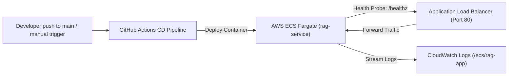

# ☁️ Beginner's Guide: AWS ECS Fargate Deployment & Continuous Deployment (CD)

This guide walks you through deploying your containerized **Advanced RAG Project** onto **AWS ECS Fargate** with zero prior AWS experience.

---

## 🏗️ Architecture Overview

---

## 📋 Prerequisites
1. An active [AWS Account](https://aws.amazon.com/).
2. Your published Docker image on Docker Hub: `contactwitharunlaudar/rag-app:develop` (or `:latest`).

---

## 🚀 Step 1: Create the Cloud Infrastructure (3 Minutes)

We provided a **1-click CloudFormation template** that automatically sets up your VPC, Load Balancer, Security Groups, and ECS Cluster.

1. Log in to the [AWS Management Console](https://console.aws.amazon.com/).
2. In the top search bar, type **CloudFormation** and click on it.
3. Make sure your AWS Region in the top-right corner is set to **US East (N. Virginia) `us-east-1`** (or your preferred region).
4. Click the orange **Create stack** button ➔ choose **With new resources (standard)**.
5. Under **Specify template**:
   - Select **Upload a template file**.
   - Click **Choose file** and upload [`deploy/aws/cloudformation.yml`](../deploy/aws/cloudformation.yml).
   - Click **Next**.
6. On the **Specify stack details** page:
   - **Stack name:** `rag-production-stack`
   - Leave all parameter defaults as they are.
   - Click **Next**.
7. Click **Next** on Configure stack options.
8. On the **Review** page:
   - Scroll to the bottom and check the box:  
     ☑️ *"I acknowledge that AWS CloudFormation might create IAM resources with custom names."*
   - Click **Submit**.

⏳ *Wait ~3 minutes while AWS creates your cluster and load balancer. When finished, the status will show `CREATE_COMPLETE`.*

---

## 🌐 Step 2: Get Your Public Web URL

1. In CloudFormation, click on your stack name (`rag-production-stack`).
2. Click on the **Outputs** tab.
3. You will see **`PublicURL`** with a link like:  
   `http://production-rag-alb-123456789.us-east-1.elb.amazonaws.com`
4. Click this link! You will see your FastAPI Swagger docs at `/docs` and the Document Knowledge Workspace UI!

---

## 🔑 Step 3: Connect GitHub to AWS for Continuous Deployment

To allow GitHub Actions to automatically deploy new code to your ECS service:

### 1. Get AWS Access Keys:
1. In the AWS Console, click your username in the top-right corner ➔ **Security credentials**.
2. Scroll to **Access keys** and click **Create access key**.
3. Select **Command Line Interface (CLI)**, check the confirmation box, and click **Next**.
4. Click **Create access key**.
5. Copy your **Access Key ID** and **Secret Access Key**.

### 2. Add Secrets to GitHub:
Go to your GitHub repository:  
👉 **[github.com/KodewithArun/End-to-End-Advanced-RAG-Project-with-LLMOPS-/settings/secrets/actions](https://github.com/KodewithArun/End-to-End-Advanced-RAG-Project-with-LLMOPS-/settings/secrets/actions)**

Click **New repository secret** and add:

| Secret Name | Value | Description |
| :--- | :--- | :--- |
| **`AWS_ACCESS_KEY_ID`** | `AKIA...` | Your AWS Access Key ID |
| **`AWS_SECRET_ACCESS_KEY`** | `wJalr...` | Your AWS Secret Access Key |
| **`AWS_REGION`** | `us-east-1` | AWS Region (default: `us-east-1`) |

---

## 🚀 Step 4: Deploying from GitHub Actions (1-Click)

Whenever you want to update your live cloud container:

1. Open your repository's [**Actions** tab](https://github.com/KodewithArun/End-to-End-Advanced-RAG-Project-with-LLMOPS-/actions).
2. On the left menu, click **Continuous Deployment to AWS ECS (Fargate)**.
3. Click the **Run workflow** button on the right:
   - Choose branch: `develop` or `main`.
   - Click **Run workflow**!

GitHub Actions will:
- Download your latest Docker image from Docker Hub.
- Deploy the updated container to your ECS cluster.
- Monitor `/healthz` to confirm the new container is healthy.
- Seamlessly transition traffic with **zero seconds of downtime**!

---

## 📊 Viewing Live Server Logs

1. In the AWS Console search bar, type **CloudWatch** ➔ click on **Log groups** on the left.
2. Select **`/ecs/rag-app`**.
3. Click on the latest log stream to see real-time FastAPI output, LangSmith traces, and RAG query events!
